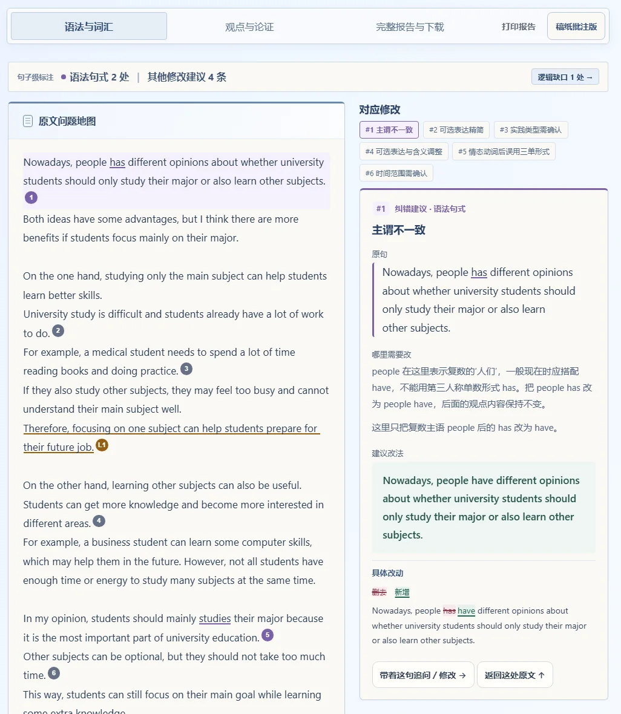
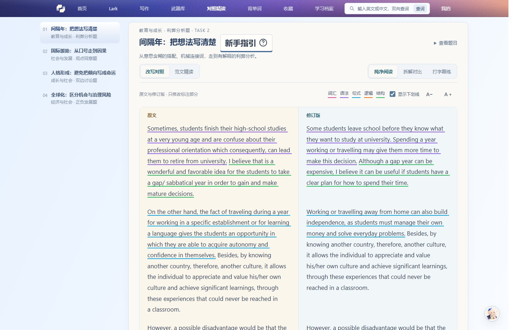

**[进入 BandLark 官网 ↗](https://bandlark.com/)**　·　[看一篇完整批改](https://bandlark.com/workspace/?page=demo&section=scores)　·　[试一组专项练习](https://bandlark.com/workspace/?page=training&mode=sentence&demo=1)

拿到一篇 6.5 分的作文，你会先改哪句话？如果保留自己的观点，这一段还缺哪一步论证？BandLark（原 EssayPilot）是为中文学习者做的 IELTS Writing Task 2 写作网站。写完初稿，你可以顺着批注读回原句，挑一个问题跟 Lark 练，再写第二稿，看看自己的修改解决了什么。

## 一篇作文是怎么改的

官网的公开示例讨论“大学生应该专攻本专业，还是也学些其他科目”。打开报告，先看到 **Overall 6.5**，以及任务回应、连贯与衔接、词汇、语法四项练习估分。往下看，报告建议作者先换掉重复、生硬的搭配，再补全“专攻一个学科为什么有利于就业”中间省略的推理。

点一下原文中的 `people has`，右侧就会解释这里的 `people` 表示复数，改成 `people have` 即可，后面的观点可以原样保留。另一处 `doing practice` 则要先弄清作者是不是想说“临床实践”，才能决定 `clinical practice` 是否贴切。写作者可以逐条核对，也可以把拿不准的句子带给 Lark 追问。

查看这篇作文的四项估分和优先修改建议

## 把一处反馈练到下一句话里

在官网的一组短练里，Lark 把 `people has` 换成一个新题材，请你补全动词。`Many people ___ that a gap year is useful.` 自己写出 `think`，再看解释，就能检验这次是否真的掌握了主谓一致。想继续练同一篇作文，可以从单句润色走到论证打磨、逐段重构，再提交第二稿，对照两稿里已经改好的地方和还需要练的问题。

## 手机上怎么学

手机打开的是同一个网站。第一次来，可以从首页的手写题卡点进示例批改；有了自己的练习记录，就从「接着学」回到上次的内容。读报告时，点一个问题，原句、修改原因和完成标准会从屏幕下方展开，收起后可以接着读。只有几分钟的时候，也可以从底栏进「学习」，选一本词书，完成当天的复习。

  
  
  

*从左到右依次是学习首页、报告批注和背词页。点图可看大图。*

## 写作之外，积累下一篇能用到的材料

在「对照精读」里打开《间隔年：把想法写清楚》，桌面上能把原文和修订版并排读。顺着同色标记看一组句子，会更容易发现作者保留了哪个意思，又怎样调整了措辞和理由。喜欢的句子可以摘录，也可以切到范文精读或打字跟练。[打开对照精读 ↗](https://bandlark.com/workspace/?page=comparison)

动笔前，可以去「武器库」按主题找语料、句式和论证方法。准备整篇练习时，写作页提供自由写作和 Task 2 机考模拟。练完以后，收藏里可以翻词汇、摘录和素材，学习档案里可以回看自己的作文记录。[打开写作页 ↗](https://bandlark.com/workspace/?page=write)　·　[浏览武器库 ↗](https://bandlark.com/workspace/?page=arsenal)

---

开发者入口和源码许可

仓库公开了写作反馈前端的部分实现，包括[把批注定位回原文](web/workspace/text-anchor.mjs)、[呈现两稿差异](web/workspace/revision-comparison.mjs)和[处理异步评分请求](web/workspace/grading-client.mjs)。[回归测试](tests/report.test.mjs)覆盖引文定位、重复句和逐词改动等情况。

前端程序使用 [GPL-3.0-only](LICENSE)。随附的 jsdiff 代码保留其 [BSD-3-Clause 许可](web/workspace/vendor/jsdiff/LICENSE)。

